# HabemUS

A keyboard layout for writing French, Spanish and the other languages written in the Latin alphabet, on a standard US QWERTY keyboard.

Without AltGr, HabemUS **is** US QWERTY: same letters, same symbols, same Ctrl shortcuts. Everything else sits on **AltGr** (the right Alt key), and the accented letters are placed **around the letter they belong to**, so you can find them without memorizing a chart.

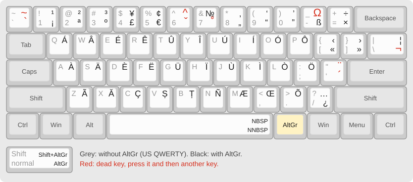

## The idea: accents around the letter

Each vowel gets a 2×2 block of keys on the AltGr layer (one colour per vowel):

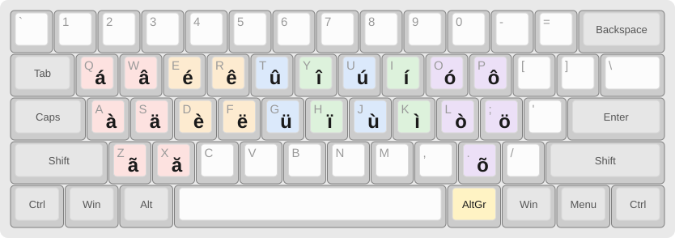

Three rules cover all of them:

1. **AltGr + the vowel gives its most common accent**: à é í ó ú.
2. **The grave accent is right below the acute**: é over è, ó over ò, ú over ù, í over ì.
3. **Circumflex and diaeresis are on the neighbouring key**: â ä next to a, ê ë next to e, ô ö next to o. For i and u they are in the block just to the left: î ï on Y H, û ü on T G.

The other letters sit on or near their base letter: **ç** on C, **ñ** on N, and **ã ă ș ț æ œ õ** on the rest of the bottom row. Shift + AltGr gives the capital (Á, Ç, Ñ…), and Caps Lock works with them too.

For French and Spanish, every accented letter you use daily is a single key press with AltGr: à é è ê ç ù ô î ï ë û œ, and á é í ó ú ñ ü ¿ ¡.

## Full AltGr layer

The keyboard picture at the top shows everything. The same layer as a searchable table:

<details>
<summary>AltGr layer as a table</summary>

Dead keys are in **bold**: press one, then a letter (see [Dead keys](#dead-keys)).

| Key | AltGr | Shift+AltGr | | Key | AltGr | Shift+AltGr |
|---|---|---|---|---|---|---|
| `` ` `` | **`** | **~** | | `A` | à | À |
| `1` | ¡ | ¹ | | `S` | ä | Ä |
| `2` | ª | ² | | `D` | è | È |
| `3` | º | ³ | | `F` | ë | Ë |
| `4` | £ | ¥ | | `G` | ü | Ü |
| `5` | € | ¢ | | `H` | ï | Ï |
| `6` | **ˇ** caron | **^** circumflex | | `J` | ù | Ù |
| `7` | **˚** ring / dot | № | | `K` | ì | Ì |
| `8` | „ | ‚ | | `L` | ò | Ò |
| `9` | “ | ‘ | | `;` | ö | Ö |
| `0` | ” | ’ | | `'` | **´** acute | **¨** diaeresis |
| `-` | ß | **Ω** Greek | | `Z` | ã | Ã |
| `=` | × | ÷ | | `X` | ă | Ă |
| `Q` | á | Á | | `C` | ç | Ç |
| `W` | â | Â | | `V` | ș | Ș |
| `E` | é | É | | `B` | ț | Ț |
| `R` | ê | Ê | | `N` | ñ | Ñ |
| `T` | û | Û | | `M` | æ | Æ |
| `Y` | î | Î | | `,` | œ | Œ |
| `U` | ú | Ú | | `.` | õ | Õ |
| `I` | í | Í | | `/` | ¿ | … |
| `O` | ó | Ó | | `\` | **¬** symbols | ¦ |
| `P` | ô | Ô | | Space | narrow no-break space | no-break space |
| `[` | « | ‹ | | | | |
| `]` | » | › | | | | |

</details>

The two no-break spaces on AltGr+Space are for French spacing: `« texte »`, `Quoi ?`.

## Dead keys

Press the dead key, release it, then type a letter. Pressing it twice, or following it with Space, types the accent itself.

| Dead key | Keys | Letters it makes |
|---|---|---|
| **^** circumflex | Shift+AltGr+6 | â ê î ô û ŵ ŷ |
| **´** acute | AltGr+' | á é í ó ú ý ć ń ś ź ŕ ł, and ő ű after ö ü (AltGr+; / AltGr+G) |
| **¨** diaeresis | Shift+AltGr+' | ä ë ï ö ü ÿ ẅ ẍ ḧ ẗ |
| **`** grave | AltGr+` | à è ì ò ù, and ą ę į ǫ ų after ä ë ï ö ü (ogonek) |
| **~** tilde | Shift+AltGr+` | ã ñ õ |
| **ˇ** caron | AltGr+6 | š č ž ř ě ň ď ť ľ ǎ ǐ ǒ ǔ ǧ ǩ ȟ ǰ ǯ ǚ |
| **˚** ring / dot above | AltGr+7 | å ů ż ċ ġ ė, and ı İ (Turkish dotless / dotted i) |
| **¬** symbols | AltGr+\ | see below |
| **Ω** Greek | Shift+AltGr+- | see below |

All of them also work with capital letters (Š, Å, Ő…).

In the pictures below, the dead key is outlined in red, each key shows what it gives after the dead key (Shift on top), and greyed keys give nothing.

### Symbols (AltGr+\ then…)

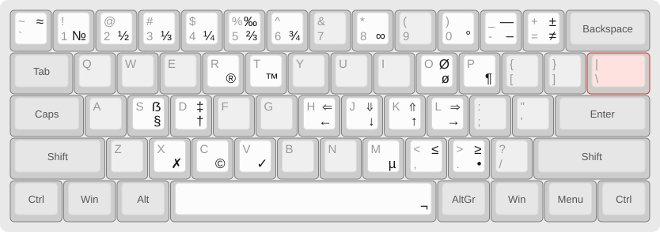

<details>
<summary>Symbols as a table</summary>

| Key | Gives | | Key | Gives | | Key | Gives |
|---|---|---|---|---|---|---|---|
| `-` | – en dash | | `c` | © | | `+` | ± |
| `_` | — em dash | | `r` | ® | | `=` | ≠ |
| `0` | ° | | `t` | ™ | | `~` | ≈ |
| `o` `O` | ø Ø | | `s` | § | | `<` `>` | ≤ ≥ |
| `S` | ẞ | | `p` | ¶ | | `8` | ∞ |
| `m` | µ (micro) | | `d` `D` | † ‡ | | `.` | • |
| `v` `x` | ✓ ✗ | | `%` | ‰ | | `1` | № |
| `h` `j` `k` `l` | ← ↓ ↑ → | | `H` `J` `K` `L` | ⇐ ⇓ ⇑ ⇒ | | `2` `3` `4` `5` `6` | ½ ⅓ ¼ ⅔ ¾ |

</details>

The arrows follow the Vim direction keys: h left, j down, k up, l right.

### Greek (Shift+AltGr+- then…)

Letters follow the Linux (X11) Greek dead key, plus final sigma on `c`:

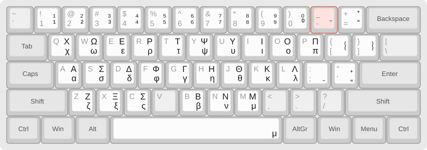

<details>
<summary>Greek letters as a table</summary>

| a | b | c | d | e | f | g | h | i | j | k | l | m |
|---|---|---|---|---|---|---|---|---|---|---|---|---|
| α | β | ς | δ | ε | φ | γ | η | ι | θ | κ | λ | μ |

| n | o | p | q | r | s | t | u | w | x | y | z |
|---|---|---|---|---|---|---|---|---|---|---|---|
| ν | ο | π | χ | ρ | σ | τ | υ | ω | ξ | ψ | ζ |

</details>

Shift gives the capitals (Shift+C gives Σ). The same dead key also makes **superscripts** from the digits and `- = + [ ]` (x² → `2`, ⁻ → `-`), and **subscripts** from the shifted digits (H₂O → `@`). Space gives μ, and pressing the dead key twice gives Ω.

### Accent dead keys

<details>
<summary>Circumflex, acute, diaeresis, grave, tilde, caron and ring</summary>

**^ circumflex** (Shift+AltGr+6)
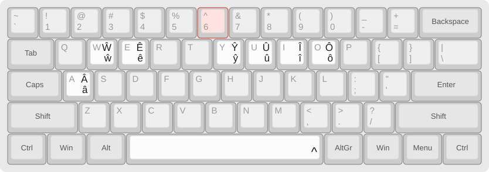

**´ acute** (AltGr+')
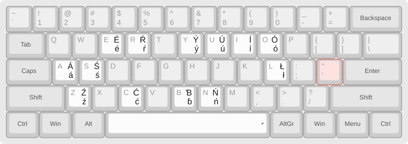

**¨ diaeresis** (Shift+AltGr+')
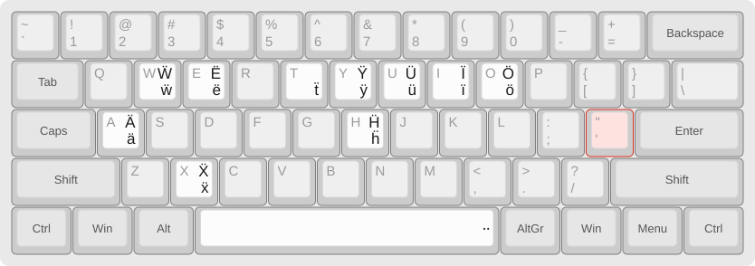

**` grave** (AltGr+`)
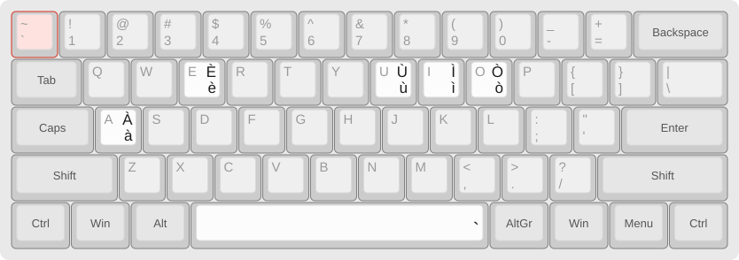

**~ tilde** (Shift+AltGr+`)
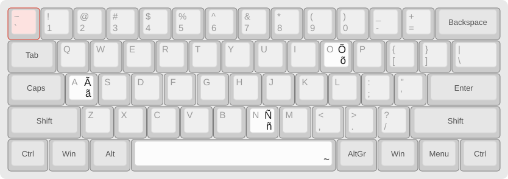

**ˇ caron** (AltGr+6)
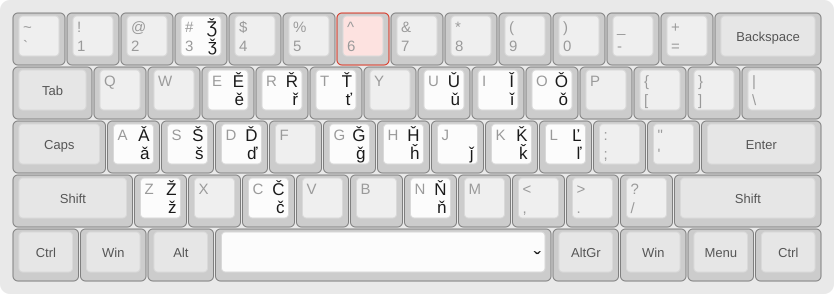

**˚ ring / dot above** (AltGr+7)
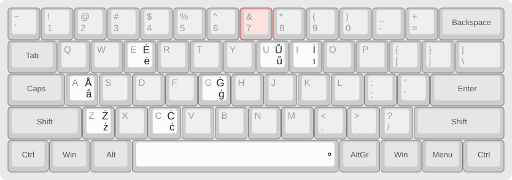

These pictures only show keys typed without AltGr. The combinations that start from an AltGr letter (´ then ö → ő, ` then ä → ą…) are listed in the table above.

</details>

## Installing

### Windows (installed layout)

The repository holds the source, [`HabemUS.klc`](HabemUS.klc), not a prebuilt installer. To build one:

1. Install [Microsoft Keyboard Layout Creator 1.4](https://www.microsoft.com/en-us/download/details.aspx?id=102134). Windows may ask you to enable an older .NET Framework.
2. Open `HabemUS.klc`, then choose **Project → Build DLL and Setup Package**.
3. Run the generated `setup.exe`, then pick **English (United States) – HabemUS** in Windows' language settings.

### Portable, no installation (PKL)

[Portable Keyboard Layout](https://github.com/Portable-Keyboard-Layout/Portable-Keyboard-Layout) runs HabemUS on top of the standard US layout, without admin rights. It works from a USB stick.

1. Download PKL (**Code → Download ZIP**) and copy `pkl.exe`, `nonASCII.ini` and the `languages\` folder into a new folder.
2. Copy the contents of this repository's [`pkl/`](pkl/) folder into the same folder (`pkl.ini` and `layouts\habemus\`).
3. Set Windows to the plain **English (United States)** layout and run `pkl.exe`.

Hold left Alt and press right Alt to pause or resume it. If a program shows the wrong characters, press Win+F12 to try another way of sending them. PKL is no longer maintained, and it can't type into programs running as administrator unless it runs as administrator too.

### Changing the layout

Edit `HabemUS.klc`, either in Keyboard Layout Creator or as text (it is UTF-16), then regenerate the PKL version and the pictures:

```
python tools/klc2pkl.py
python tools/klc2svg.py
```

The pictures in [`docs/`](docs/) are SVG files drawn from the `.klc`, in the style of [keyboard-layout-editor.com](http://www.keyboard-layout-editor.com/).

## Credits

HabemUS started from **[EurKEY](https://eurkey.steffen.bruentjen.eu/)** by Steffen Brüntjen, version 1.3. From EurKEY it keeps:

- the AltGr number row, quotation marks and punctuation: ¡ ª º £ €, ¹ ² ³ ¥ ¢, „ “ ” ‚ ‘ ’, « » ‹ ›, × ÷, ¿ …
- the contents of the circumflex, acute, diaeresis, grave and tilde dead keys
- the caron and ring/dot-above dead keys. HabemUS adds ů ė ı İ to the second one
- the idea of a symbol dead key on AltGr+\, with its arrows and fractions
- the superscripts, subscripts and Space → μ of the Greek dead key

HabemUS changes:

- the AltGr letter keys, rearranged into the "accents around the letter" blocks above. EurKEY favours Germanic and Nordic letters, while HabemUS favours French and Spanish
- ă ș ț for Romanian, ő ű for Hungarian, and the two no-break spaces
- the Greek letters, which follow the Linux standard (`dead_greek` in [libX11's Compose table](https://gitlab.freedesktop.org/xorg/lib/libx11/-/raw/master/nls/en_US.UTF-8/Compose.pre)) instead of EurKEY's Windows mapping, plus ς
- the symbol dead key contents, which add dashes, ©, ®, ™ and the other symbols listed above

The portable version runs on [Portable Keyboard Layout](https://github.com/Portable-Keyboard-Layout/Portable-Keyboard-Layout) by Máté Farkas.
